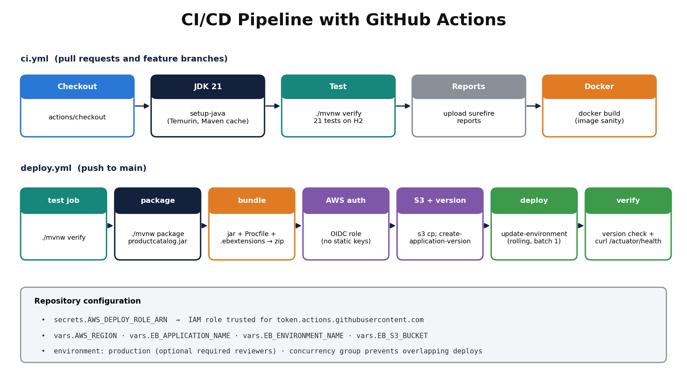
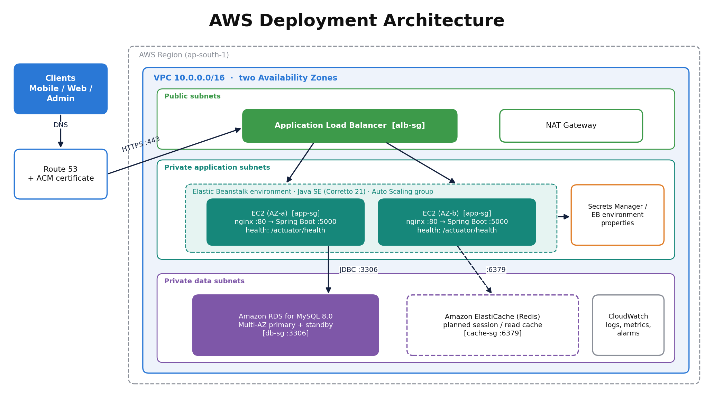
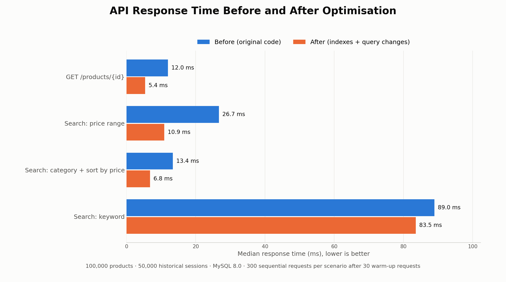
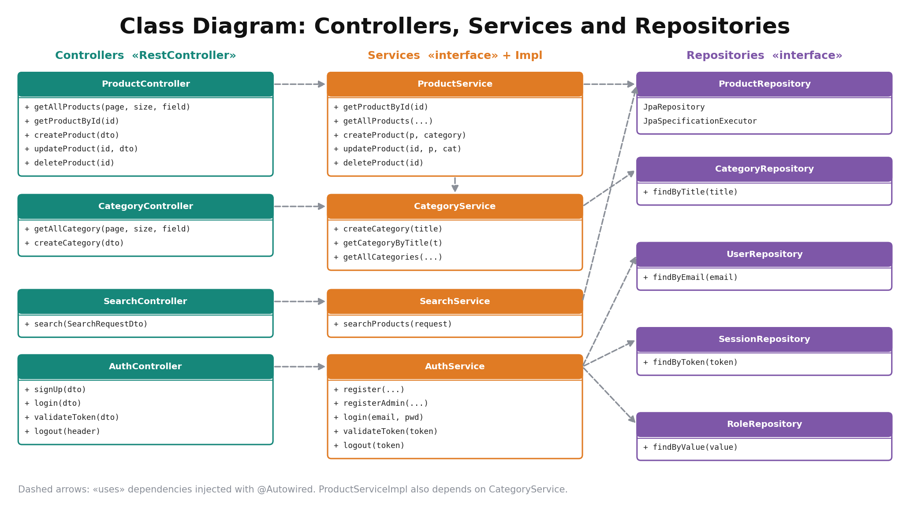

# Product Catalog REST API

A secure, production-ready RESTful backend service for managing e-commerce product catalogs — built with **Java 21**, **Spring Boot**, **Spring Security (JWT, role-based access)**, and **MySQL**, containerised via **Docker** and deployed to **AWS Elastic Beanstalk** with **GitHub Actions**.

---

## Table of Contents

1. [Project Description](#1-project-description)
2. [Objectives](#2-objectives)
3. [Relevance & Real-World Applications](#3-relevance--real-world-applications)
4. [System Architecture](#4-system-architecture)
5. [Authentication Flow](#5-authentication-flow)
6. [Product Search Flow](#6-product-search-flow)
7. [Data Model](#7-data-model)
8. [API Reference](#8-api-reference)
9. [Tech Stack](#9-tech-stack)
10. [Getting Started](#10-getting-started)
11. [Low Level Design (LLD)](#11-low-level-design-lld)
    - [11.1 Class Diagrams](#111-class-diagrams)
    - [11.2 Database Schema Design](#112-database-schema-design)

---

## 1. Project Description

The **Product Catalog REST API** is a backend service that provides structured, secure, and scalable access to product and category data. It is designed to act as the data backbone for any client-facing e-commerce application — whether a mobile storefront, a web shop, or an internal admin dashboard.

The system exposes a clean JSON API that allows authenticated users to:

- **Register and log in** with JWT-based authentication
- **Browse products** with pagination and sorting
- **Organise products into categories**
- **Search products** using full-text keywords, category filters, and price ranges — all in a single request
- **Manage the full lifecycle** of products (create, read, update, delete)

The project follows a classic layered architecture — Controller → Service → Repository → Database — enforcing a clear separation of concerns, making the codebase maintainable, testable, and extensible.

---

## 2. Objectives

| # | Objective | Description |
|---|-----------|-------------|
| 1 | **Secure Access Control** | Implement stateless authentication using JSON Web Tokens (JWT) so that every API call is independently verifiable without server-side session state. |
| 2 | **Structured Product Management** | Provide a complete CRUD interface for products and categories with data integrity guarantees via JPA/Hibernate. |
| 3 | **Powerful Search** | Enable multi-parameter product search (keyword + category + price range) through composable JPA Specifications, returning paginated and sortable results. |
| 4 | **Scalable Data Model** | Design a clean, extensible data model where all entities share common audit fields (created, updated, active) via a shared `BaseModel`. |
| 5 | **Easy Deployment** | Package the database layer as a Docker container so the entire stack can be spun up with a single command on any machine. |
| 6 | **Developer Productivity** | Include a Python seed script to populate the database with realistic, randomised product data for testing and demonstration. |

---

## 3. Relevance & Real-World Applications

### Why this matters

Modern commerce — retail, healthcare supply chains, food delivery, logistics — depends on reliable inventory data accessible in real time across multiple surfaces. A product catalog API is the foundational building block that powers:

| Industry | Application |
|----------|-------------|
| **E-Commerce** | Powers product listing pages, search, and filters on platforms like Amazon, Flipkart, or niche D2C stores |
| **Retail & POS Systems** | Provides live stock lookups from point-of-sale terminals in physical stores |
| **Healthcare** | Manages medical supply catalogs for hospitals and procurement teams |
| **Logistics & Warehousing** | Tracks SKUs, categories, and pricing across distribution networks |
| **Food & Grocery Delivery** | Drives menu/catalog browsing, filtering by dietary category and price tier |
| **B2B Procurement Platforms** | Lets enterprise buyers search and compare supplier product offerings at scale |

### Key Technical Relevance

- **Stateless JWT auth** is the industry standard for microservices and mobile-first applications, where maintaining server-side sessions is impractical.
- **Dynamic JPA Specifications** allow the search engine to build SQL queries at runtime based on whatever filters the user provides — a pattern used extensively in enterprise search platforms.
- **Containerised infrastructure** via Docker means the same codebase can run identically on a developer's laptop, a CI server, or a cloud VM — eliminating "works on my machine" problems.
- **Pagination and sorting** are essential for any real-world dataset — without them, a catalog of 100,000+ products would make every API response unusably large.

---

## 4. System Architecture

The application follows a clean layered architecture. Clients communicate exclusively through HTTP. Every request passes through a security filter before reaching any business logic.


### Layer breakdown

```
Clients (Mobile / Web / Dashboard)
         │
         ▼  HTTP/HTTPS
┌─────────────────────────────────────────┐
│         Spring Boot API Server          │
│  ┌──────────────┐  ┌─────────────────┐  │
│  │ JWT Auth     │  │  Controllers    │  │
│  │ Filter       │  │  /products      │  │
│  │              │  │  /category      │  │
│  │ Auth         │  │  /search        │  │
│  │ Controller   │  │  /auth          │  │
│  └──────────────┘  └─────────────────┘  │
│  ┌───────────────────────────────────┐  │
│  │  Service Layer                    │  │
│  │  ProductService │ AuthService     │  │
│  └───────────────────────────────────┘  │
│  ┌───────────────────────────────────┐  │
│  │  Repository Layer (Spring JPA)    │  │
│  └───────────────────────────────────┘  │
└─────────────────────────────────────────┘
         │
         ▼
┌────────────────────────┐
│  MySQL 8.0 (Docker)    │
└────────────────────────┘
```

---

## 5. Authentication Flow

All protected routes require a valid JWT Bearer token. Below is the complete sequence from registration through to accessing a protected resource.


**Key design decisions:**
- Passwords are **never stored in plain text** — BCrypt hashing with a cost factor is applied at registration.
- JWT tokens have a **10-minute expiry** to limit the damage window if a token is leaked.
- Tokens are also stored server-side in a `Session` table, enabling **server-initiated revocation** (e.g., logout).
- The `JwtAuthenticationFilter` runs on **every request** as a `OncePerRequestFilter`, populating the Spring `SecurityContext` before any controller code executes.

---

## 6. Product Search Flow

The search engine supports combining multiple filters in a single request — keyword, category, and price range — using JPA Specifications to build the SQL query dynamically at runtime.


**Example search request:**

```json
POST /search
{
  "query": "samsung",
  "category": "Smartphones",
  "minPrice": 10000,
  "maxPrice": 80000,
  "pageNumber": 0,
  "pageSize": 10,
  "sortBy": "price",
  "sortDirection": "asc"
}
```

**Example response:**

```json
{
  "content": [ { "id": 12, "title": "Samsung Galaxy A52", "price": 27999.00, ... } ],
  "totalElements": 3,
  "totalPages": 1,
  "pageNumber": 0
}
```

---

## 7. Data Model

All entities inherit from `BaseModel`, which provides audit fields (`createdAt`, `updatedAt`, `isActive`) automatically.


### Entity Summary

| Entity | Purpose | Key Fields |
|--------|---------|------------|
| `User` | Registered API user | `email`, `password` (BCrypt), `firstName`, `lastName` |
| `Role` | User permission level | `value` (e.g. `NON_ADMIN_USER`) |
| `Session` | Active JWT token record | `token` (JWT string), linked to `User` |
| `Product` | Catalog item | `title`, `description`, `imageUrl`, `price`, linked to `Category` |
| `Category` | Product grouping | `title`, linked to many `Products` |

### Relationships

```
User ──< Session          (one user → many sessions)
User >──< Role            (many-to-many via join table)
Category ──< Product      (one category → many products)
```

---

## 8. API Reference

All endpoints except `/auth/signup`, `/auth/login`, `/auth/validate` and `/actuator/health` require an
`Authorization: Bearer <JWT>` header. Write endpoints additionally require the `ADMIN` role.
Errors are always returned as `{"message": "...", "status": <code>}`.

### Authentication

| Method | Endpoint | Access | Description |
|--------|----------|--------|-------------|
| `POST` | `/auth/signup` | Public | Register a new user (role `NON_ADMIN_USER`), returns `201` |
| `POST` | `/auth/login` | Public | Login, returns JWT in the `Authorization` header |
| `POST` | `/auth/validate` | Public | Validate a JWT token |
| `POST` | `/auth/logout` | Authenticated | Revoke the current token, returns `204` |

### Products

| Method | Endpoint | Access | Description |
|--------|----------|--------|-------------|
| `GET` | `/products?pageNumber=0&pageSize=10&fieldName=id` | Authenticated | List products (paginated, sortable, page size 1 to 100) |
| `GET` | `/products/{id}` | Authenticated | Get a single product by ID |
| `POST` | `/products` | ADMIN | Create a product in an existing category, returns `201` |
| `PUT` | `/products/{id}` | ADMIN | Update a product |
| `DELETE` | `/products/{id}` | ADMIN | Delete a product |

### Categories

| Method | Endpoint | Access | Description |
|--------|----------|--------|-------------|
| `GET` | `/category?pageNumber=0&pageSize=10&fieldName=id` | Authenticated | List categories (paginated) |
| `POST` | `/category` | ADMIN | Create a category (titles are unique, duplicates return `409`) |

### Search

| Method | Endpoint | Access | Description |
|--------|----------|--------|-------------|
| `POST` | `/search` | Authenticated | Search by keyword, category (exact, case-insensitive) and/or price range |

**Supported `sortBy` fields for products:** `id`, `title`, `price`, `createdAt`, `updatedAt` (anything else falls back to `id`).

Paged responses use a stable structure:

```json
{ "content": [ ... ], "page": { "size": 10, "number": 0, "totalElements": 42, "totalPages": 5 } }
```

### Operations

| Method | Endpoint | Access | Description |
|--------|----------|--------|-------------|
| `GET` | `/actuator/health` | Public | Health check used by the load balancer |

---

## 9. Tech Stack

| Layer | Technology |
|-------|------------|
| Language | Java 21 |
| Framework | Spring Boot 4.0.3 |
| Web | Spring MVC + Jakarta Bean Validation |
| Security | Spring Security (role-based) + JWT (`jjwt` 0.13.0) + BCrypt |
| Persistence | Spring Data JPA + Hibernate |
| Database | MySQL 8.0 (H2 for tests) |
| Observability | Spring Boot Actuator (health) |
| Testing | JUnit 5, Mockito, MockMvc |
| Containerisation | Docker (multi-stage image) + Docker Compose |
| CI/CD | GitHub Actions → AWS Elastic Beanstalk |
| Boilerplate reduction | Lombok |
| Build tool | Maven (Maven Wrapper included) |
| Seed data | Python 3 (stdlib only) |

---

## 10. Getting Started

### Prerequisites

- Java 21+
- Maven or use the included `./mvnw` wrapper
- Docker & Docker Compose

### Option A: run everything in Docker

```bash
docker compose -f docker/docker-compose.yaml up -d --build
curl http://localhost:8080/actuator/health
```

The compose file creates a bootstrap admin `admin@productcatalog.local` / `ChangeMe123!` (local use only).

### Option B: database in Docker, application from source

```bash
docker compose -f docker/docker-compose.yaml up -d db
ADMIN_EMAIL=admin@example.com ADMIN_PASSWORD='ChangeMe123!' ./mvnw spring-boot:run
```

The API will be available at `http://localhost:8080`.

### Run the tests

```bash
./mvnw verify      # 21 unit and integration tests, uses in-memory H2
```

### Seed the database

Products and categories can only be created by an `ADMIN`, so seed with the bootstrap admin account:

```bash
python3 scripts/seed_catalog.py \
  --base-url http://localhost:8080 \
  --email admin@productcatalog.local \
  --password 'ChangeMe123!' \
  --products 100
```

This creates 10 categories and 100 products with realistic randomised data.

### Environment Variables

| Variable | Default | Description |
|----------|---------|-------------|
| `SPRING_DATASOURCE_URL` | `jdbc:mysql://localhost:3306/productcatalog?createDatabaseIfNotExist=true` | JDBC URL |
| `SPRING_DATASOURCE_USERNAME` / `SPRING_DATASOURCE_PASSWORD` | `root` / `my-secret-pw` | Database credentials, **override in production** |
| `JWT_SECRET` | Base64 demo key | HMAC key for signing JWTs (at least 256 bits), **override in production** |
| `JWT_EXPIRY_MINUTES` | `10` | Token lifetime |
| `ADMIN_EMAIL` / `ADMIN_PASSWORD` | empty | Creates the first `ADMIN` user at start-up if it does not exist |
| `SPRING_JPA_HIBERNATE_DDL_AUTO` | `update` | Hibernate schema mode |
| `SPRING_JPA_SHOW_SQL` | `false` | Log generated SQL |

### Deployment (GitHub Actions → AWS Elastic Beanstalk)



- `.github/workflows/ci.yml` builds, tests and builds the Docker image on every pull request.
- `.github/workflows/deploy.yml` tests, packages and deploys every push to `main`:
  it zips `productcatalog.jar` with `deploy/beanstalk/Procfile` and `.ebextensions`, uploads it to S3,
  creates an application version, performs a rolling update and verifies `/actuator/health`.

Repository configuration required by `deploy.yml`:

| Kind | Name | Value |
|------|------|-------|
| Secret | `AWS_DEPLOY_ROLE_ARN` | IAM role trusted for GitHub OIDC (`token.actions.githubusercontent.com`) |
| Variable | `AWS_REGION` | e.g. `ap-south-1` |
| Variable | `EB_APPLICATION_NAME` | Elastic Beanstalk application |
| Variable | `EB_ENVIRONMENT_NAME` | Elastic Beanstalk environment (Java SE / Corretto 21, load balanced) |
| Variable | `EB_S3_BUCKET` | Bucket for application versions |

Database credentials, `JWT_SECRET` and `ADMIN_*` are set once as environment properties on the Beanstalk environment.



### Performance

With 100,000 products and 50,000 historical sessions, indexes on `session.token`, `product.price` and
`product(category_id, price)` cut median latency by 55% (product by id), 59% (price-range search) and
49% (category search). Keyword search (`LIKE '%term%'`) is not index-assisted.



---

## 11. Low Level Design (LLD)

### 11.1 Class Diagrams

The class diagram below captures the full structure of the application — models, service interfaces and their implementations, controllers, and repositories — along with their dependencies and relationships.

**Figure 1 — UML Class Diagram: Product Catalog API**



*Figure 1: UML Class Diagram showing Controllers, Service interfaces, Service implementations, Domain Models (all inheriting from BaseModel), and JPA Repositories with their dependencies and associations.*

#### Class Descriptions

**Models Layer**

| Class | Type | Responsibility |
|-------|------|----------------|
| `BaseModel` | Abstract (`@MappedSuperclass`) | Shared audit fields: `id`, `createdAt`, `updatedAt`, `isActive` — inherited by all entities |
| `Product` | Entity | Represents a catalog item; holds `title`, `description`, `imageUrl`, `price`; many-to-one link to `Category` |
| `Category` | Entity | Groups products by type; one-to-many link to `Product` list (lazy-loaded, JSON-ignored) |
| `User` | Entity | Registered API consumer; holds credentials and a many-to-many link to `Role` |
| `Role` | Entity | Permission label (e.g. `NON_ADMIN_USER`) assigned to users |
| `Session` | Entity | Active JWT token record; many-to-one link to the owning `User` |

**Services Layer**

| Interface | Implementation | Key Responsibilities |
|-----------|---------------|---------------------|
| `ProductService` | `ProductServiceImpl` | CRUD on products, pagination, sort validation, category resolution |
| `AuthService` | `AuthServiceImpl` | BCrypt password hashing, JWT generation (10-min expiry), token validation, session management |
| `CategoryService` | `CategoryServiceImpl` | Category creation and lookup by title |
| `SearchService` | `SearchServiceImpl` | Builds composable `JPA Specification` from keyword, category, and price-range filters |

**Controllers Layer**

| Controller | Route Prefix | Delegates To |
|------------|-------------|--------------|
| `ProductController` | `/products` | `ProductService` |
| `AuthController` | `/auth` | `AuthService` |
| `CategoryController` | `/category` | `CategoryService` |
| `SearchController` | `/search` | `SearchService` |

**Repositories Layer**

| Repository | Extends | Special Capability |
|------------|---------|-------------------|
| `ProductRepository` | `JpaRepository`, `JpaSpecificationExecutor` | Supports dynamic `Specification`-based queries for search |
| `CategoryRepository` | `JpaRepository` | Lookup by title |
| `UserRepository` | `JpaRepository` | Lookup by email |
| `SessionRepository` | `JpaRepository` | Lookup by token string |
| `RoleRepository` | `JpaRepository` | Lookup by value |

---

### 11.2 Database Schema Design

#### Schema Description (Textual)

**Tables:**

```
product
  id            BIGINT          PRIMARY KEY (Hibernate product_seq)
  title         VARCHAR(255)    NOT NULL
  description   VARCHAR(2000)
  image_url     VARCHAR(1000)
  price         DOUBLE          NOT NULL   INDEX idx_product_price
  category_id   BIGINT          FK → category(id)   INDEX idx_product_category_price (category_id, price)
  created_at    DATETIME(6)
  updated_at    DATETIME(6)
  is_active     BIT

category
  id            BIGINT          PRIMARY KEY
  title         VARCHAR(255)    NOT NULL UNIQUE
  created_at, updated_at, is_active

user
  id            BIGINT          PRIMARY KEY
  email         VARCHAR(255)    NOT NULL UNIQUE
  password      VARCHAR(255)    NOT NULL  (BCrypt hash)
  first_name    VARCHAR(255)
  last_name     VARCHAR(255)
  created_at, updated_at, is_active

role
  id            BIGINT          PRIMARY KEY
  value         VARCHAR(255)    NOT NULL UNIQUE  (ADMIN, NON_ADMIN_USER)
  created_at, updated_at, is_active

session
  id            BIGINT          PRIMARY KEY
  token         VARCHAR(512)    NOT NULL UNIQUE  (idx_session_token, JWT string)
  user_id       BIGINT          FK → user(id)
  created_at, updated_at, is_active

user_roles  (join table — many-to-many)
  user_id       BIGINT          FK → user(id)
  roles_id      BIGINT          FK → role(id)
```

**Foreign Keys:**

```
product(category_id)      → category(id)
session(user_id)          → user(id)
user_roles(user_id)       → user(id)
user_roles(roles_id)      → role(id)
```

**Cardinality of Relations:**

| Relationship | Cardinality | Description |
|---|---|---|
| `product` ↔ `category` | M : 1 | Many products belong to one category |
| `user` ↔ `role` | M : M | A user can have many roles; a role can be assigned to many users |
| `user` ↔ `session` | 1 : M | One user can have multiple active sessions (tokens) |

#### Schema Diagram

**Figure 2 — Database Schema: Product Catalog**


*Figure 2: Entity-Relationship schema diagram showing all six tables (product, category, user, role, session, user_roles), their column definitions with data types and constraints, foreign-key relationships with their cardinalities, and the indexes added for performance.*

---

*Built with Spring Boot · Secured with JWT · Containerised with Docker*
