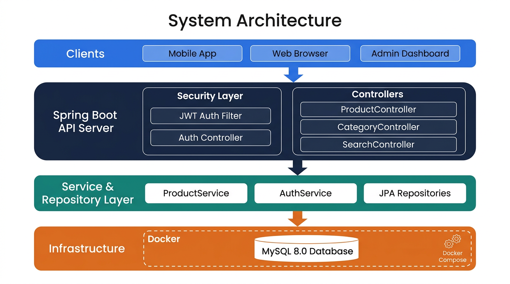
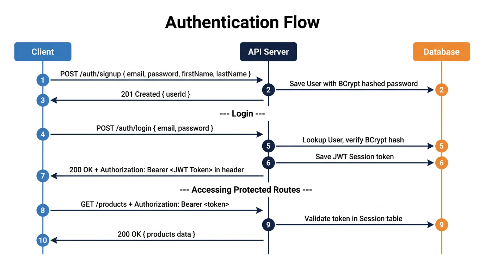
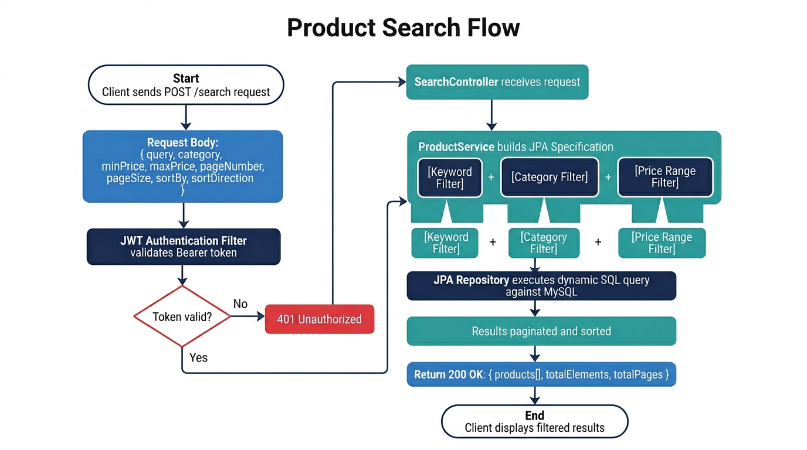
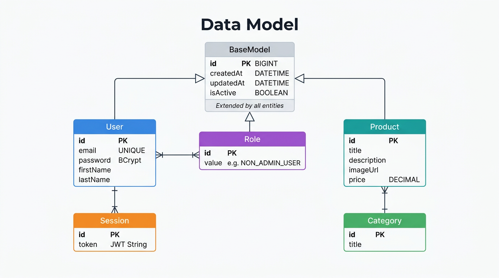

# Product Catalog REST API

A secure, production-ready RESTful backend service for managing e-commerce product catalogs — built with **Java 21**, **Spring Boot**, **Spring Security (JWT)**, and **MySQL**, containerised via **Docker**.

---

## Table of Contents

1. [Project Description](#1-project-description)
2. [Objectives](#2-objectives)
3. [Relevance & Real-World Applications](#3-relevance--real-world-applications)
4. [System Architecture](#4-system-architecture)
5. [Authentication Flow](#5-authentication-flow)
6. [Product Search Flow](#6-product-search-flow)
7. [Data Model](#7-data-model)
8. [API Reference](#8-api-reference)
9. [Tech Stack](#9-tech-stack)
10. [Getting Started](#10-getting-started)

---

## 1. Project Description

The **Product Catalog REST API** is a backend service that provides structured, secure, and scalable access to product and category data. It is designed to act as the data backbone for any client-facing e-commerce application — whether a mobile storefront, a web shop, or an internal admin dashboard.

The system exposes a clean JSON API that allows authenticated users to:

- **Register and log in** with JWT-based authentication
- **Browse products** with pagination and sorting
- **Organise products into categories**
- **Search products** using full-text keywords, category filters, and price ranges — all in a single request
- **Manage the full lifecycle** of products (create, read, update, delete)

The project follows a classic layered architecture — Controller → Service → Repository → Database — enforcing a clear separation of concerns, making the codebase maintainable, testable, and extensible.

---

## 2. Objectives

| # | Objective | Description |
|---|-----------|-------------|
| 1 | **Secure Access Control** | Implement stateless authentication using JSON Web Tokens (JWT) so that every API call is independently verifiable without server-side session state. |
| 2 | **Structured Product Management** | Provide a complete CRUD interface for products and categories with data integrity guarantees via JPA/Hibernate. |
| 3 | **Powerful Search** | Enable multi-parameter product search (keyword + category + price range) through composable JPA Specifications, returning paginated and sortable results. |
| 4 | **Scalable Data Model** | Design a clean, extensible data model where all entities share common audit fields (created, updated, active) via a shared `BaseModel`. |
| 5 | **Easy Deployment** | Package the database layer as a Docker container so the entire stack can be spun up with a single command on any machine. |
| 6 | **Developer Productivity** | Include a Python seed script to populate the database with realistic, randomised product data for testing and demonstration. |

---

## 3. Relevance & Real-World Applications

### Why this matters

Modern commerce — retail, healthcare supply chains, food delivery, logistics — depends on reliable inventory data accessible in real time across multiple surfaces. A product catalog API is the foundational building block that powers:

| Industry | Application |
|----------|-------------|
| **E-Commerce** | Powers product listing pages, search, and filters on platforms like Amazon, Flipkart, or niche D2C stores |
| **Retail & POS Systems** | Provides live stock lookups from point-of-sale terminals in physical stores |
| **Healthcare** | Manages medical supply catalogs for hospitals and procurement teams |
| **Logistics & Warehousing** | Tracks SKUs, categories, and pricing across distribution networks |
| **Food & Grocery Delivery** | Drives menu/catalog browsing, filtering by dietary category and price tier |
| **B2B Procurement Platforms** | Lets enterprise buyers search and compare supplier product offerings at scale |

### Key Technical Relevance

- **Stateless JWT auth** is the industry standard for microservices and mobile-first applications, where maintaining server-side sessions is impractical.
- **Dynamic JPA Specifications** allow the search engine to build SQL queries at runtime based on whatever filters the user provides — a pattern used extensively in enterprise search platforms.
- **Containerised infrastructure** via Docker means the same codebase can run identically on a developer's laptop, a CI server, or a cloud VM — eliminating "works on my machine" problems.
- **Pagination and sorting** are essential for any real-world dataset — without them, a catalog of 100,000+ products would make every API response unusably large.

---

## 4. System Architecture

The application follows a clean layered architecture. Clients communicate exclusively through HTTP. Every request passes through a security filter before reaching any business logic.



### Layer breakdown

```
Clients (Mobile / Web / Dashboard)
         │
         ▼  HTTP/HTTPS
┌─────────────────────────────────────────┐
│         Spring Boot API Server          │
│  ┌──────────────┐  ┌─────────────────┐  │
│  │ JWT Auth     │  │  Controllers    │  │
│  │ Filter       │  │  /products      │  │
│  │              │  │  /category      │  │
│  │ Auth         │  │  /search        │  │
│  │ Controller   │  │  /auth          │  │
│  └──────────────┘  └─────────────────┘  │
│  ┌───────────────────────────────────┐  │
│  │  Service Layer                    │  │
│  │  ProductService │ AuthService     │  │
│  └───────────────────────────────────┘  │
│  ┌───────────────────────────────────┐  │
│  │  Repository Layer (Spring JPA)    │  │
│  └───────────────────────────────────┘  │
└─────────────────────────────────────────┘
         │
         ▼
┌────────────────────────┐
│  MySQL 8.0 (Docker)    │
└────────────────────────┘
```

---

## 5. Authentication Flow

All protected routes require a valid JWT Bearer token. Below is the complete sequence from registration through to accessing a protected resource.



**Key design decisions:**
- Passwords are **never stored in plain text** — BCrypt hashing with a cost factor is applied at registration.
- JWT tokens have a **10-minute expiry** to limit the damage window if a token is leaked.
- Tokens are also stored server-side in a `Session` table, enabling **server-initiated revocation** (e.g., logout).
- The `JwtAuthenticationFilter` runs on **every request** as a `OncePerRequestFilter`, populating the Spring `SecurityContext` before any controller code executes.

---

## 6. Product Search Flow

The search engine supports combining multiple filters in a single request — keyword, category, and price range — using JPA Specifications to build the SQL query dynamically at runtime.



**Example search request:**

```json
POST /search
{
  "query": "samsung",
  "category": "Smartphones",
  "minPrice": 10000,
  "maxPrice": 80000,
  "pageNumber": 0,
  "pageSize": 10,
  "sortBy": "price",
  "sortDirection": "asc"
}
```

**Example response:**

```json
{
  "content": [ { "id": 12, "title": "Samsung Galaxy A52", "price": 27999.00, ... } ],
  "totalElements": 3,
  "totalPages": 1,
  "pageNumber": 0
}
```

---

## 7. Data Model

All entities inherit from `BaseModel`, which provides audit fields (`createdAt`, `updatedAt`, `isActive`) automatically.



### Entity Summary

| Entity | Purpose | Key Fields |
|--------|---------|------------|
| `User` | Registered API user | `email`, `password` (BCrypt), `firstName`, `lastName` |
| `Role` | User permission level | `value` (e.g. `NON_ADMIN_USER`) |
| `Session` | Active JWT token record | `token` (JWT string), linked to `User` |
| `Product` | Catalog item | `title`, `description`, `imageUrl`, `price`, linked to `Category` |
| `Category` | Product grouping | `title`, linked to many `Products` |

### Relationships

```
User ──< Session          (one user → many sessions)
User >──< Role            (many-to-many via join table)
Category ──< Product      (one category → many products)
```

---

## 8. API Reference

### Authentication

| Method | Endpoint | Auth | Description |
|--------|----------|------|-------------|
| `POST` | `/auth/signup` | No | Register a new user |
| `POST` | `/auth/login` | No | Login — returns JWT in `Authorization` header |
| `POST` | `/auth/validate` | No | Validate a JWT token |

### Products

| Method | Endpoint | Auth | Description |
|--------|----------|------|-------------|
| `GET` | `/products` | Yes | List all products (paginated, sortable) |
| `GET` | `/products/{id}` | Yes | Get a single product by ID |
| `POST` | `/products` | Yes | Create a new product |
| `PUT` | `/products/{id}` | Yes | Update a product |
| `DELETE` | `/products/{id}` | Yes | Delete a product |

### Categories

| Method | Endpoint | Auth | Description |
|--------|----------|------|-------------|
| `GET` | `/category` | Yes | List all categories (paginated) |
| `POST` | `/category` | Yes | Create a new category |

### Search

| Method | Endpoint | Auth | Description |
|--------|----------|------|-------------|
| `POST` | `/search` | Yes | Search products by keyword, category, and/or price range |

**Supported `sortBy` fields for products:** `id`, `title`, `price`, `createdAt`, `updatedAt`

---

## 9. Tech Stack

| Layer | Technology |
|-------|------------|
| Language | Java 21 |
| Framework | Spring Boot 4.0.3 |
| Web | Spring MVC |
| Security | Spring Security + JWT (`jjwt` 0.13.0) |
| Persistence | Spring Data JPA + Hibernate |
| Database | MySQL 8.0 |
| Containerisation | Docker + Docker Compose |
| Boilerplate reduction | Lombok |
| Build tool | Maven (Maven Wrapper included) |
| Seed data | Python 3 (stdlib only) |

---

## 10. Getting Started

### Prerequisites

- Java 21+
- Maven or use the included `./mvnw` wrapper
- Docker & Docker Compose

### 1. Start the database

```bash
cd docker
docker compose up -d
```

### 2. Run the application

```bash
./mvnw spring-boot:run
```

The API will be available at `http://localhost:8080`.

### 3. (Optional) Seed the database

```bash
python3 scripts/seed_catalog.py \
  --base-url http://localhost:8080 \
  --email test@example.com \
  --password secret123 \
  --products 100
```

This creates 10 categories and 100 products with realistic randomised data.

### Environment Variables

| Variable | Default | Description |
|----------|---------|-------------|
| `JWT_SECRET` | Base64 demo key | Secret key for signing JWT tokens — **override in production** |

---

*Built with Spring Boot · Secured with JWT · Containerised with Docker*
